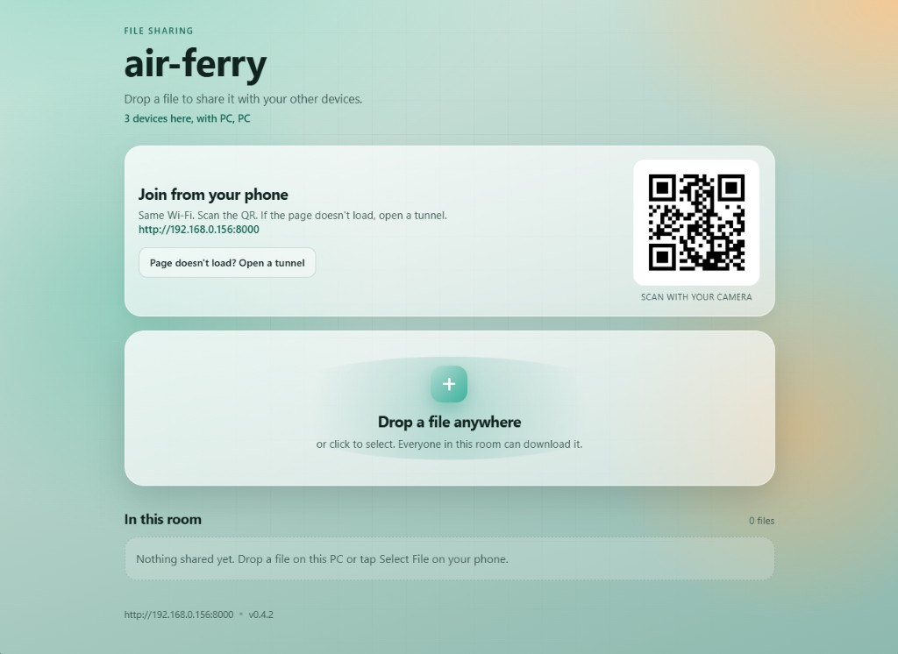

# air-ferry

Share files between your PC (Linux/Windows) and phone. Web UI, system tray, WebSockets, Local network by default, optional cloudflare tunnel for when the router blocks device to device traffic.



Stack: Python 3.10+, FastAPI, uvicorn, websockets, zeroconf, rich, typer, pystray

## Install

**Linux** (Python 3.10+). Install and run:

```bash
python3 -m pip install --user "git+https://github.com/theluckytiger/air-ferry.git" && air-ferry
```

**Windows:** download the `.exe` from [Releases](https://github.com/theluckytiger/air-ferry/releases) and run it.

## Use

1. On Windows, approve UAC once if asked (firewall allow rules for phones)
2. Browser UI opens; the app stays in the tray
3. Scan the QR on your phone (same Wi-Fi)
4. If the page does not load, click **Open a tunnel** (QR switches). Click **Close tunnel** when done
5. Drop or select a file on either side, then download on the other

Tray: open UI, copy link, open/close tunnel, quit. Quitting always stops the tunnel.

Optional terminal mode (Linux / from source): `air-ferry-tui`

## License

MIT
